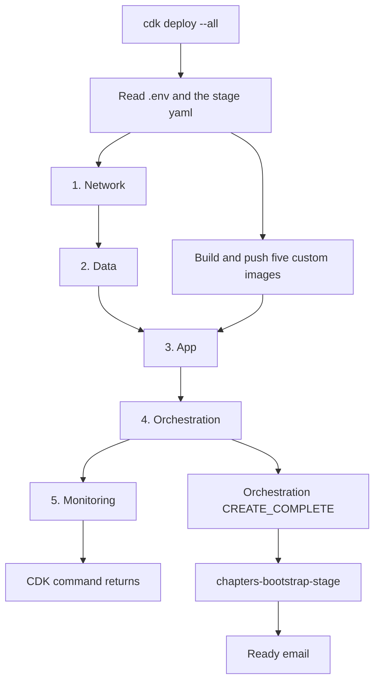

# Overview

Read this first. It is the map of the project: what problem it solves, what is running, how a question is answered, what happens after deploy, and where the other pages go deeper.

The running system is an Open WebUI site on AWS. The support assistant `oikb Ops Assistant` answers from a knowledge base that lives in Open WebUI.

The one-shot setup program, `python -m bootstrap.run`, creates that knowledge base on the first run. It sends the name `oikb` with the create request, and Open WebUI assigns the id. A later run finds the knowledge base by that name and keeps it.

oikb keeps that knowledge base current with long-running oikb-daemon. Its GitHub connector reads the public repository `github.com/open-webui/oikb` and writes the files into the knowledge base. oikb-daemon's own timer runs that sync every 15 minutes, after the setup program has synced once, so the copy the assistant searches can lag `main` by that long.

Two other ways stay open for later. See [ADR 0001](adr/0001-freshness.md). A GitHub webhook can ask oikb-daemon to sync on each push once an owner or an admin of `open-webui/oikb` adds the hook. The token in this deployment reads Contents, Issues, and Pull requests, so adding that hook belongs to whoever controls the repository. The 15-minute timer would stay, so a missed hook would still sync. Alternatively, that same read token could check the latest commit and start a sync only when the commit changes.

When a question needs a live look at issues or recent changes, the assistant can also call GitHub, and that call is read-only. If the copy stops updating, an email goes out. The cdk infrastructure lives under`infra/`. The pages under `docs/` are the write-up that goes with it.

## The problem

Open WebUI is run as a shared chat product for other customers. A platform admin's support team uses oikb to help customers set up knowledge-base sync. The copy of oikb's documentation and code inside the Hub is stale, so support answers from old material.

The admin wants four things:

- An assistant that answers from the current oikb repository.
- That same assistant to notice when a question touches a known bug or a recent change.
- A guarantee that the Hub cannot change any code repository. Read is allowed. Write is not.
- A way to hear that the sync is broken before the support team notices it.

This repository is a small, real version of that. Leaving extra machinery out is part of the design. The [decision record](decision-record.md) answers the task's four questions. [ADR 0004](adr/0004-scope.md) says how to add what was left out.

## What is running

Three services stay up. The next section names those services, the proxies inside their tasks, and the AWS services on the path. Three other tasks run once during setup and then exit.

| Piece | What it does |
|---|---|
| Vector task | One shot. Runs `CREATE EXTENSION IF NOT EXISTS vector` so the database can store embeddings. |
| Migrate task | One shot. Applies Open WebUI's database schema. The website itself has migrations turned off, so a restart does not change the schema. |
| Bootstrap | One shot. Signs in, creates or reuses the knowledge base named `oikb`, installs the context filter, creates the assistant, registers the GitHub tool, syncs once, asks six check questions, and writes a report to S3. |

## Services and proxies

The three long-running tasks are ECS services. A proxy runs in the same task as the program it fronts, and it is not its own service. The load balancer does not publish those proxy ports.

| Piece | Kind | What it does |
|---|---|---|
| Open WebUI | Service `web-<stage>` | The website, container `web`, port 8080. Users, chats, the assistant, and the knowledge base. The load balancer forwards only to this service. |
| github-mcp | Service `mcp-<stage>` | GitHub's MCP server, started with `http --read-only`, on `127.0.0.1:8083` in that task. The website cannot open that port. |
| github-mcp-proxy | Proxy, container `mcp-proxy` | Port 8082 on the github-mcp task. Cloud Map publishes this port as `github-mcp`. It drops any Authorization header from the caller, adds the GitHub token, and forwards to github-mcp. Open WebUI never sees the token. |
| oikb-daemon | Service `daemon-<stage>` | Copies `github.com/open-webui/oikb` into the knowledge base every 15 minutes. Inside the task it listens on port 8080 and serves `GET /metrics` and `GET /health`. |
| notify-proxy | Proxy, container `notify-proxy` | `127.0.0.1:8089` in the oikb-daemon task. oikb-daemon POSTs here on a sync error. The proxy signs that body with the task role and calls the notify Lambda. |
| sync-metrics | Container `sync-metrics` | Once a minute it reads oikb-daemon's metrics and health pages and publishes the current totals and the latest sync to CloudWatch namespace `Chapters/Oikb`. `GET /health` on `127.0.0.1:8091` tells ECS this container is up. |

These AWS services sit on that path. Who may connect, and the port list, are in the [reference](reference.md).

| Service | What it does |
|---|---|
| Application Load Balancer | Public entry for the site. Port 80 redirects to 443. Forwards only to Open WebUI. Access logs are kept 14 days. |
| WAF | 2000 requests per five minutes per address. A burst above that is blocked. |
| RDS PostgreSQL 16 | Database `openwebui`. Accounts, chats, sessions, the assistant, knowledge-base rows, and pgvector embeddings. |
| Stage S3 bucket | File bytes synced from the repository, and the evaluation report. |
| Cloud Map | Private namespace `chapters-<stage>.local`. `web` is Open WebUI on port 8080. `github-mcp` is github-mcp-proxy on port 8082. |
| NAT gateway | Outbound path from the private subnets to OpenAI, GitHub, and the public image registries. Calls to S3 use the gateway endpoint. |
| Notify Lambda `chapters-oikb-notify-<stage>` | Receives the signed sync-error POST and publishes it to the alerts topic. |
| Slack Lambda `chapters-slack-<stage>` | Posts the alerts-topic subject and body to Slack. |
| SNS topic `chapters-alerts-<stage>` | Emails `SNS_EMAIL`. Ready mail, setup failure, sync errors, and health alarms share this topic. |
| Step Functions `chapters-bootstrap-<stage>` | The setup workflow. EventBridge starts it when the Orchestration stack finishes creating or updating. |

## The assistant

`oikb Ops Assistant` (id `oikb-ops-assistant`) is a saved model. Bootstrap picks the base model from `gpt-5-mini`, `gpt-4.1-mini`, and `gpt-4o-mini`, in that order, when Open WebUI lists it. The description under the name is: "Answers from the oikb knowledge base, and from read-only GitHub when a question needs a live issue, commit, or pull request." The pieces attached to that model are below. How a live GitHub call crosses the VPC is in [Architecture](architecture.md).

| Kind | What is used | What it does |
|---|---|---|
| Skills | None attached | A workspace skill is a markdown file the model loads when a task needs those steps. Every call sends this system prompt: "You are the oikb Ops Assistant. Answer from the oikb knowledge base and the read-only GitHub tools. A question about where something is in the synced code uses the knowledge base only. Do not call GitHub for that question. Start with the file path copied from a retrieved passage's File line. A route, a function name, or a source id is not a file. Do not offer to search later. If no retrieved passage names a file, say the file was not in the retrieved pages. A question about a live issue, commit, or pull request uses the read-only GitHub tools. Name the file or connector you used." |
| Rules | Filter `oikb_context_budget` | Active on this assistant only. It runs on the request hook after retrieval and after the tool definitions are attached. It writes `File:` and the file name at the start of a retrieved passage that carries one, then shortens the payload sent to the model. The chat stored in Open WebUI stays complete. The caps are in the next section. |
| Rules | Write-tool check | During setup, bootstrap reads the MCP tool list. An empty list, or a tool name that looks like a write, stops setup, and oikb-daemon is not started. |
| MCP | `github-mcp` | One tool server, type `mcp`, auth `none`, URL `http://github-mcp.chapters-<stage>.local:8082`. The description stored on it is "Read-only GitHub MCP". The proxy holds the token. |
| Tools | Default toolsets, read-only | The server is started with no toolset list, so it registers context, repos, issues, pull requests, and users. `--read-only` leaves the write tools in those sets unregistered. The model calls the read tools for a live issue, pull request, commit, or file. Answers about the synced library come from the `oikb` knowledge base. |

## A question, from the browser

A person opens `https://` plus the stage hostname. The load balancer accepts only `ALLOWED_IPS`. Both stage files currently set that to `0.0.0.0/0`, so the public name is open and the WAF is the throttle: 2000 requests per address every five minutes. Port 80 redirects to 443. The load balancer sends the request to the one Open WebUI task.

Open WebUI reads the account, the chat, and the assistant from PostgreSQL. The assistant's documents are the knowledge base. The file bytes of those documents are objects in the stage S3 bucket. The embeddings that make search work are pgvector rows in the same database.

The chat on screen stays complete. Before each model call, a filter on `oikb Ops Assistant` writes `File:` and the file name at the start of a retrieved passage that carries one, then shortens only the request sent to the model. The name on the passage is the uploaded file name. The collection name is not used as that file.

It keeps the system prompt, the current question, and any passages already written into that question. It keeps the GitHub tool definitions and the three preceding exchanges. It also keeps an older turn that names the same file, issue, commit, or connector id, such as `github:open-webui/oikb`.

A commit counts in one of three cases. It is a full id of 40 or 64 hex characters. It sits in a GitHub commit URL, or after `@`. Or the message says "commit" or "sha" next to it.

Other older turns stay in the chat and are left out of that request. If the request is still over the cap, the oldest of those three exchanges is left out until it fits.

If the question itself is still over the cap, the copy sent to the model drops the retrieved `<source>` passages. If the person's own words are still over the cap, that copy becomes a short note asking for a smaller question. The chat on screen keeps the full text.

A tool result that is too large on its own is replaced with the path, issue, or commit it refers to. The note names the tool and says not to call it again with the same arguments. The tool stays available for a different call. A tool call stays with its result.

The cap follows the selected model: 80,000 tokens for `gpt-4o-mini`, 170,000 for `gpt-5-mini`, and 650,000 for `gpt-4.1-mini`. Tokens are estimated as characters divided by 4. Each cap is about five eighths of the text that model accepts, so the reply still fits when the estimate undercounts. An unknown model uses 80,000. Bootstrap installs the filter. Open WebUI's summarizer stays off. If the filter fails, the request keeps the system prompt and the current question.

If the question needs a live look at GitHub, Open WebUI calls `http://github-mcp.chapters-<stage>.local:8082`. That name exists only inside the VPC. github-mcp was started with `--read-only`, and the token it uses can only read Contents, Issues, and Pull requests. Bootstrap refuses to finish if a write tool shows up in the tool list. The website task never receives the GitHub token.

## How the library stays current

oikb-daemon's GitHub connector reads `github.com/open-webui/oikb` and writes those files into the Open WebUI knowledge base. `containers/oikb/.oikb.yaml` names that source `github:open-webui/oikb` and sets the interval to 15 minutes, so the library can lag `main` by that long. Files that leave the repository are removed on a later sync. Re-checking a public repository that has not changed is cheap.

Once a minute, a small program in that same task reads oikb-daemon's `/metrics` and `/health` pages and publishes the current numbers to CloudWatch. The totals count from the first reading: syncs that succeeded, finished with some file errors, or failed, and files uploaded and deleted since this task started. The latest sync is published every minute: when it finished, how long it took, files added, changed, and removed, and how long until the next one. The dashboard shows those as numbers, and shows requests, answers, errors, and the database beside them. One page load is about 200 requests. A history line is written when a sync finishes. If a sync has been running for more than an hour, or the daemon task is up but stops reporting, an alarm emails the admin and posts the same note to Slack.

On a sync error oikb-daemon POSTs to `127.0.0.1:8089` in the same task. The signer there calls the notify Lambda with the oikb-daemon task role. The function publishes to an SNS topic. The topic emails the address in the stage file, and a Lambda posts the same subject and body to Slack. The same topic carries the ready mail, the setup-failure mail, and the health alarms. The email subscription has to be confirmed once by a person. Until that click, the emails do not arrive. Slack posts as soon as the deploy finishes. The webhook URL is `SLACK_WEBHOOK_URL` in `infra/.env`.

## After deploy

`cdk deploy --all`, from `infra/`, reads `infra/.env` and the stage file (`infra/config.dev.yaml`, or `infra/config.prod.yaml` with `-c stage=prod`). It builds the five stacks, then returns. The assistant exists when the ready email arrives. The commands are in [Deploy](deploy.md). What each stack owns is in the table under The five stacks, below.

While CloudFormation is still creating stacks:

- Five images are built on your machine and pushed at the same time: bootstrap, github-mcp-proxy, oikb, notify-proxy, and sync-metrics. That overlaps Network and Data.
- Open WebUI and oikb-daemon are created with zero tasks. github-mcp starts at one task.
- EventBridge starts `chapters-bootstrap-<stage>` when Orchestration reaches `CREATE_COMPLETE` or `UPDATE_COMPLETE`. Monitoring may still be deploying, and the command may still be running.
- A deploy that changes nothing leaves the workflow unstarted.
- A deploy that only changes the application image updates App. Start `chapters-bootstrap-<stage>` once after it. That run keeps the existing knowledge base and assistant.

| Step | What the workflow does |
|---|---|
| 1 | Create the pgvector extension. |
| 2 | Run the Open WebUI migration. Continue only on exit 0. |
| 3 | Start one website task. |
| 4 | Wait 30 seconds, then run bootstrap. Bootstrap polls `/health/db` for up to 20 minutes. |
| 5 | Start one oikb-daemon task. |
| 6 | Send the ready email, with the site URL. |

A failed step emails the stage, the site URL, the time, the error, and the log group names. oikb-daemon stays at zero.

Sign in with `WEBUI_ADMIN_EMAIL` and `WEBUI_ADMIN_PASSWORD` from `infra/.env`. A new account can use the site immediately, and it can open `oikb Ops Assistant`.

Bootstrap, on that run:

- Signs in as the admin. Creating that account turns signup off, so bootstrap turns it back on and sets the new-account role from `infra/.env`. It shares the knowledge base and `oikb Ops Assistant`.
- Replaces two secrets that deploy stored as the literal `pending`: the Open WebUI API key, and the knowledge-base id. A base named `oikb` keeps its id. Otherwise Open WebUI assigns one on `POST /api/v1/knowledge/create`. oikb-daemon later reads it as `KB_ID`.
- Registers github-mcp, imports `oikb Ops Assistant`, syncs the repository once, waits until those files are processed, asks the six evaluation questions, and writes the report to `reports/<stage>/<stamp>.json`. `reports/<stage>/latest.json` names that object. `latest.txt` is the short summary.
- A weak answer is recorded, and the task exits 0. Health, sign-in, a write tool, or file processing fails the task.

Still a person, once:

- Confirm the SNS subscription email so the ready mail, the failure mail, and the health alarms can arrive. Slack posts those same notes as soon as the topic subscription exists.
- Confirm the AWS Budgets email. In Billing, activate the `Service` cost allocation tag once.

## What survives a new container

Fargate replaces the task disk when a task stops. The Open WebUI task mounts no volume, so a restart, a deploy, or a crash leaves an empty container filesystem. Anything that must still be there lives outside the task.

| What | Where |
|---|---|
| Users, chats, settings, the assistant, knowledge-base rows | RDS PostgreSQL 16, database `openwebui` |
| Session cookies | Signed with `WEBUI_SECRET_KEY`, generated once per stage and kept in Secrets Manager. A new task reads the same key, so an existing login still works. |
| Embeddings | pgvector in that same database |
| Synced file bytes, and the evaluation report | The stage S3 bucket |

The database is encrypted, single-AZ, and closed to the internet. It sits in isolated subnets with no route out. Tasks connect straight to it. There is no RDS Proxy. One website task with one worker process does not need a connection pool in front of PostgreSQL.

## Names, networks, and who can connect

Everything is in `us-east-1`. The VPC has public, private, and isolated subnets across two availability zones, and one NAT gateway.

The load balancer and the NAT gateway sit in the public subnets. Open WebUI, github-mcp, oikb-daemon, and the one-shot tasks sit in the private subnets with no public IP. Their calls to OpenAI, GitHub, and the public image registries go out through the NAT gateway. Their calls to S3 use a gateway endpoint on the private route tables, so that traffic does not pass through the NAT. PostgreSQL sits in the isolated subnets and has no route to S3.

Two DNS names matter, and they are not the same thing:

- The public name, from the stage file, points at the load balancer. That is the URL in the ready email.
- The App stack creates a private Cloud Map namespace `chapters-<stage>.local` in the VPC. The website registers as `web` on port 8080 (`http://web.chapters-<stage>.local:8080`). github-mcp-proxy registers as `github-mcp` on port 8082 (`http://github-mcp.chapters-<stage>.local:8082`). Those names resolve only inside the VPC. Bootstrap and oikb-daemon use them, so those calls never go through the public load balancer or its IP allow-list.

## The five stacks

CDK deploys five stacks, and each one may use only the stacks before it. Data does not know the website exists. Monitoring only reads the earlier stacks.

| Order | Stack | Owns |
|---|---|---|
| 1 | Network | The VPC, the subnets, one NAT gateway, and an S3 gateway endpoint on the private subnets |
| 2 | Data | PostgreSQL, the stage bucket, and the database security group |
| 3 | App | The cluster, the load balancer, the public DNS name, the private Cloud Map namespace, the three services, the one-shot task definitions, the sync metrics publisher, the SNS topic, the notify Lambda, and the Slack Lambda |
| 4 | Orchestration | The setup workflow and the rule that starts it |
| 5 | Monitoring | Alarms, plain-language alarm mail, the dashboard, a monthly budget, and the WAF rate limit |

The App stack is the one that opens port 5432 from the application tasks to the database. Stage settings that are safe to commit live in `infra/config.dev.yaml` and `infra/config.prod.yaml`. Names go through `stagified` in `infra/utils/index.ts`, so a dev resource and a prod resource do not collide. Secrets (`OPENAI_API_KEY`, `GITHUB_TOKEN`, the admin email and password, `SLACK_WEBHOOK_URL`) come from the environment at deploy time, filled in from `infra/.env` when the shell has not set them. That file is not committed.

Images, ports, and environment variables are listed in the [reference](reference.md).

## The four decisions

These are the task's four questions. The options, the trade-off, and what would change the choice are in the [decision record](decision-record.md). The longer write-up of each is the ADR with the same number.

1. **Freshness.** Fifteen minutes is fresh enough. oikb-daemon's own schedule triggers the sync, and the sync runs in its own task. See [ADR 0001](adr/0001-freshness.md).
2. **Access scope.** The github-mcp task is private, started with `--read-only`, and the token can only read Contents, Issues, and Pull requests. The website task does not receive the token. See [ADR 0002](adr/0002-access-scope.md).
3. **Failure detection.** A reported sync error emails the admin. A setup that never starts oikb-daemon sends a different email. A sync that stays running for more than an hour sends another. A download still inside that hour does not. See [ADR 0003](adr/0003-failure-detection.md).
4. **Scope.** Leave out a second website task, Redis, Tika, an ECR copy of the images, a webhook, a standing grader, and RDS Proxy. Those are extra. The URL, the current library, read-only GitHub, durable sessions, and the failure email are not. See [ADR 0004](adr/0004-scope.md).

## What this demo leaves out

On purpose: a second website task, Redis, Apache Tika, a private copy of the public images in ECR, a GitHub webhook, a grader that keeps scoring chats after bootstrap, and RDS Proxy. Before prod is a real environment, confirm the certificate and `SNS_EMAIL`, and replace `ALLOWED_IPS: 0.0.0.0/0`. How to add each item is in [ADR 0004](adr/0004-scope.md).

## Where to go next

| If you want | Read |
|---|---|
| The request path, the network, and what each stack owns, in more detail | [Architecture](architecture.md) |
| Why a choice was made, and how to add what was left out | [Decision record](decision-record.md) and the [ADRs](adr/0001-freshness.md) |
| How a deploy actually goes, including the email you have to confirm | [Deploy](deploy.md) |
| Images, ports, environment variables, and secrets | [Reference](reference.md) |
| How assistant answers are judged | [Eval proposal](eval-proposal.md) |
| The automated checks, and what each one covers | [Tests](tests.md) |
